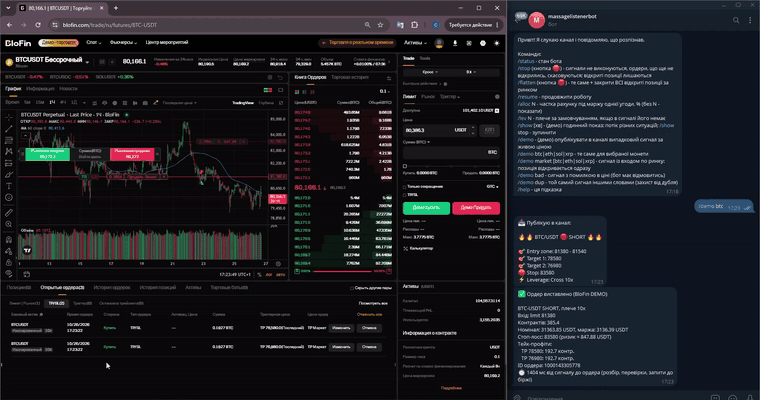

# BloFin Signal Bot

[](https://github.com/niapard-commits/blofin-signal-bot/actions/workflows/tests.yml)


<p align="center"></p>

Portfolio project built to a real Upwork job post (fixed price, $500). 129 tests; verified on the BloFin demo exchange.

A Telegram-signal → BloFin futures trading bot, written in Python.
It reads trading signals from a Telegram channel, parses them **strictly**, checks them against the live
market, sizes the position from the account balance, places the entry with stop-loss and take-profits,
and reports every decision back to the owner in Telegram.

> **Rule number one: if anything is unclear, the bot does NOT trade.**
> A missed trade costs nothing; a wrong trade costs money.

It runs against the **BloFin DEMO exchange by default**. Real trading needs two explicit switches
(see [Going live](#going-live)) and has **not** been exercised by the author (see [What is verified](#what-is-verified-and-what-is-not)).

---

## How it works

```
Telegram channel ──► parse ──► duplicate guard ──► live-market checks ──► position sizing ──► BloFin
 (your account)      │            │                   │                      │                  │
                     │ unclear?   │ seen before?      │ price typo? SL on    │ too small /      │ entry + SL
                     ▼            ▼                   ▼ the wrong side?      ▼ no free margin?  ▼ + TP legs
                  DO NOT TRADE  DO NOT TRADE        DO NOT TRADE          DO NOT TRADE     owner is notified
```

Every step that says "do not trade" tells the owner **why**, in a Telegram message and in the log.

### What counts as a "do not trade"
- the message is incomplete or ambiguous (no stop-loss, two different SL values, LONG and SHORT in one post, …)
- the coin is not listed on the exchange
- stop-loss on the wrong side of the entry, or a take-profit on the wrong side
- take-profit already behind the live price, or stop-loss already hit (the exchange would reject the
  take-profit, and a half-protected position is worse than none, so the **whole** trade is refused)
- an entry price far from the live price (catches missing digits and decimal-separator mistakes)
- stop-loss too close to entry or too far, take-profit absurdly far
- the signal is older than 2 minutes
- the position would be below the exchange's minimum size, or the stop-loss lies beyond the liquidation distance
- **not enough free margin** (open positions and pending orders lock margin)
- the same trade was already handled in the last 24 h (duplicate, even if worded differently)
- the bot is paused (`/stop`)

## Features (mapped to the brief)

| Requirement | Implementation |
|---|---|
| Read signals from a Telegram channel | Telethon user client reads the channel |
| Strict parsing, unclear → no trade | `signalbot/parser.py`: tolerant of formats (emoji, Ukrainian/Russian/English labels, zones, `Target 1`…), strict on acceptance |
| Position size from balance × allocation, configurable leverage | `signalbot/sizing.py`; `ALLOCATION_PCT`, `DEFAULT_LEVERAGE`, `MAX_LEVERAGE`; changeable live with `/alloc` and `/lev` |
| Automatic take-profit and stop-loss | SL attached to the entry; one TP rides on the entry, several TPs become separate reduce-only orders |
| Duplicate-signal protection | atomic SQLite claim on a fingerprint of the trade (survives restarts) + the fingerprint is the exchange `clientOrderId`, so the exchange itself rejects a second copy |
| Low latency | parallel requests, shared balance request, persistent HTTPS connections (see [Latency](#latency)) |
| Error handling and logging | every failure becomes a readable message; `bot.log` (rotating) + a permanent decision journal in `signals.db` |
| Emergency shutdown | `/stop` and `/flatten` (also as buttons) |
| Demo / testing before real trading | BloFin DEMO by default, a built-in signal generator (`/demo`, `/show`), 129 unit tests |
| Clean, documented code | small modules, type hints, docstrings that explain *why* |

## Signal formats it understands

```
BTCUSDT LONG                      🔥🔥 ETH/USDT 🟢 LONG 🔥🔥            🟢 ЛОНГ BTCUSDT
Entry: 65000                      🎯 Entry zone: 2440 - 2445           Вхід: 65000
SL: 64000                         🎯 Target 1: 2542                    Ціль 1: 66000
TP1: 66000                        🎯 Target 2: 2592                    Ціль 2: 67000
TP2: 67000                        🛑 Stop: 2379                        Стоп-лосс: 64000
Leverage: 10x                     ⚡ Leverage: Cross 10x                Плече: 10х
```

Entry can be a price, a zone (`2440 - 2445`) or `market`. A zone is sized at its worst-case price.
Trade updates ("TP1 hit", "move SL to breakeven"), adverts and chatter are **ignored** and never trigger an order.

## Setup (Windows, Python 3.10+)

```bat
git clone <this repo>
cd blofin-signal-bot
python -m venv .venv
.venv\Scripts\activate
pip install -r requirements.txt
copy .env.example .env
```

Then open `.env` in a text editor and fill it in.

You need:
1. **Telegram API id/hash** from <https://my.telegram.org> → *API development tools*.
2. **A bot token** from [@BotFather](https://t.me/BotFather). Open the bot once and press *Start*.
3. **A BloFin DEMO API key** (Trade permission; Read is implied; **no** Transfer/Withdraw).
   Use a passphrase with letters and digits only.
4. The exact **title** of the signal channel your account reads, in `TG_CHANNEL`.

Never commit `.env` or `*.session` files (they are in `.gitignore`).

Run these in order; only steps 4 and 5 can place orders:

1. `python -m unittest discover -s tests -t .` runs all tests (they must pass)
2. `python blofin_check.py` is read-only: prints balance, free margin, contract and price
3. `python listen.py` prints how every channel post is understood, no trading
4. `python demo_order.py` places one small DEMO limit order (asks you to type YES)
5. `python bot.py` runs the full bot

On the first run Telegram asks for your phone number and a login code; a local session file is created.

## Using the bot

All commands work only for the account owner. Buttons under the input field mirror the important ones.

| Command / button | What it does |
|---|---|
| `/status` / 📊 | exchange, balance, state, settings, counters, latency |
| `/stop` / 🛑 *Cancel unfilled* | pause; cancel the bot's entry orders that have not filled (and their take-profits). **Open positions are left alone, with their SL/TP.** |
| `/flatten` / 🔴 *Close ALL* | pause; cancel unfilled entries **and** close every open position at market |
| `/resume` / ▶️ | continue |
| `/alloc N` | percent of the account used as margin per trade (0 < N ≤ 100) |
| `/lev N` | default leverage when a signal has none (1…max) |
| `/demo [btc\|eth\|sol\|xrp\|market\|bad\|dup]` | demo only: publish a realistic signal into the channel around the live price |
| `/show [minutes]` | demo only: a scripted stream of situations (valid signals in many formats, rejections, duplicates, emergency stop, deliberate "not enough margin") that ends by closing all positions and printing a summary; `/show stop` ends it |

`/stop` and `/flatten` are deliberately different: cancelling orders that never filled is always safe, while
closing a position fixes a profit or a loss at that moment. `/stop` only touches orders created by this bot.
**`/flatten` closes every open position on the account, including ones you opened by hand**, so use a dedicated account.

## Configuration (`.env`)

| Variable | Meaning | Default |
|---|---|---|
| `TG_API_ID`, `TG_API_HASH` | Telegram API credentials | required |
| `TG_CHANNEL` | exact title of the signal channel | required |
| `BOT_TOKEN` | Telegram bot token (control chat and notifications) | required |
| `EXCHANGE` | `mock` (in-memory simulator) or `blofin` | `mock` |
| `BLOFIN_ENV` | `demo` or `prod` | `demo` |
| `BLOFIN_API_KEY`, `BLOFIN_API_SECRET`, `BLOFIN_PASSPHRASE` | BloFin API credentials | required for `blofin` |
| `BLOFIN_ALLOW_REAL` | must be `yes` to start with `BLOFIN_ENV=prod` | unset |
| `ALLOCATION_PCT` | % of the account used as margin per trade | `25` |
| `DEFAULT_LEVERAGE` | leverage if the signal has none | `10` |
| `MAX_LEVERAGE` | hard cap; overrides the leverage in a signal | `20` |
| `BLOFIN_KEEPALIVE` | `no` turns persistent connections off | `yes` |

Position sizing: `margin = balance × allocation%`, `notional = margin × leverage`, contracts = notional / entry,
rounded **down** to the exchange lot size. Leverage = min(signal, `MAX_LEVERAGE`, instrument maximum).

## Latency

Measured on the BloFin DEMO server from Slovakia (signal received → order accepted by the exchange,
including parsing, all checks, leverage, entry and three take-profit legs):

| Version | Time |
|---|---|
| sequential requests, new connection each time | ≈ 4.8 s |
| independent requests in parallel, one balance request | ≈ 2.5 s |
| + persistent connections kept warm | **≈ 1.3–1.8 s** |

What remains is network round trips: the chain is *read market → set leverage → entry → take-profits*, four
dependent steps of ≈ 0.3 s each from this location. Every order's request timings are written to `bot.log`
(`http: 7 requests: …`) so the bottleneck is visible. These are single measurements on a demo server, not a benchmark.

## What is verified, and what is not

**Verified against the real BloFin DEMO exchange** (manually, with screenshots/recording):
request signing; balance, free margin, instrument and price reads; position-mode detection (one-way);
set-leverage; limit and market entries with attached stop-loss; multiple take-profit legs;
cancelling unfilled entries together with their take-profits; closing positions at market; the exchange
refusing a take-profit behind the market (which became a validation rule); the bot's own refusal when free margin is insufficient.

**Verified only by automated tests** (129, no network): the parser on a large corpus of messy signals, validation,
sizing, the duplicate guard, the order pipeline against a mock exchange, request bodies against a fake BloFin
server, hedge-mode (long/short) request bodies, pagination and batching of cancels, the persistent-connection
transport against a local HTTP server.

**Not verified:**
- **Real-money trading (`prod`) has never been run.** Treat it as untested. Start with the demo, then with tiny sizes.
- Hedge (long/short) position mode is only covered by the fake-server tests; *multi-position* mode is refused on purpose.
- Behaviour under exchange outages, rate limiting for very high signal volumes, and very long unattended runs.

## Known limitations
- One signal channel, one exchange, USDT-margined perpetual futures, isolated margin.
- Take-profits split the position evenly (in whole lots); no trailing stop, no move-to-breakeven after TP1.
- Edited messages and follow-up posts ("TP1 hit") are ignored; each post is evaluated once.
- Market entries pay the exchange's taker fee and slippage; closing at market does too.
- Market-data checks use the exchange's last price, not the order book.

## Project layout

```
bot.py                  the bot: Telegram I/O, commands, notifications, show
signalbot/parser.py     free-form text → Signal (or "do not trade" with a reason)
signalbot/validation.py safety checks against the live market
signalbot/sizing.py     balance × allocation × leverage → contracts
signalbot/executor.py   parse result → checks → size → orders (the pipeline)
signalbot/exchange.py   Exchange interface + in-memory MockExchange
signalbot/blofin.py     BloFin REST client (signing, orders, cancel, positions, pooled transport)
signalbot/store.py      SQLite: duplicate guard + decision journal
signalbot/demo.py       realistic signal generator for demos and tests
blofin_check.py         read-only exchange check
demo_order.py           one small DEMO order
listen.py               read-only listener (no trading)
tests/                  129 unit tests (python -m unittest)
```

## Going live

Not recommended before long demo runs of your own. If you decide to: create a **production** API key with
Trade permission only, put it in `.env`, set `BLOFIN_ENV=prod` **and** `BLOFIN_ALLOW_REAL=yes`. `/demo` and `/show`
are disabled in that mode. Start with a small allocation (`/alloc 1`) and watch the first trades.

## Disclaimer
This is software, not financial advice. Futures trading with leverage can lose more than you expect, quickly.
You are responsible for any use of it. No warranty (see LICENSE).

---

**Need a Telegram signal or trading bot?** Order or ask a question via [my Fiverr gig](https://www.fiverr.com/serhii_bots/build-a-custom-python-telegram-bot).
